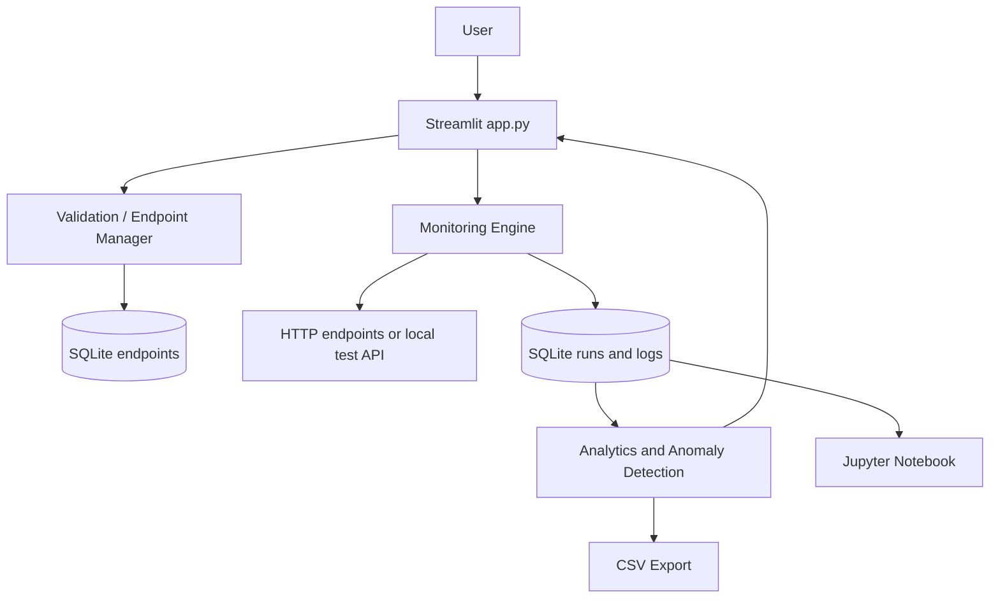
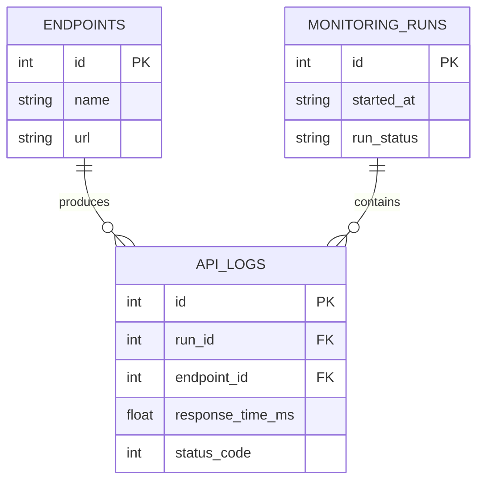

# Architecture

## Component responsibilities
- `app.py`: Streamlit presentation and user interaction; no SQL business logic beyond calling the database module.
- `config/settings.py`: project-relative paths and conservative defaults.
- `src/validation.py`: HTTP/HTTPS URL validation, method and timeout bounds, opt-in local testing.
- `src/endpoint_manager.py`: validates and delegates endpoint create/update operations.
- `src/monitor.py`: one-shot HTTP calls, monotonic latency, error classification, bounded `ThreadPoolExecutor`, result persistence.
- `src/database.py`: schema initialization, parameterized SQL, foreign keys, indexes, historical queries, maintenance.
- `src/analytics.py`: Pandas normalization and NumPy/Pandas metrics.
- `src/anomaly_detection.py`: rolling-median and IQR detectors.
- `src/export.py`: CSV export.
- `scripts/`: local mock server, controlled experiment, synthetic dataset generator.
- `tests/`: deterministic tests against a local server and temporary SQLite files.

## Data flow

## Database relationship

## Concurrency and failure isolation
Sequential mode calls each endpoint one by one. Concurrent mode submits at most the configured bounded worker count to `ThreadPoolExecutor`; each future retains its endpoint association. A request failure becomes a record, and a worker exception is converted into a worker-error record so other results can be saved. Requests are I/O-bound, so threads can overlap waiting for network responses without needing CPU parallelism.

## Error model
A response outside the configured expected status range is `http_error` and has a status code and measured latency. Connection timeout, read timeout, connection error, invalid URL, request exception, and unexpected exception are separate categories. `status_code` remains null when no HTTP response arrives. Response bodies are not stored in SQLite; only response byte length is retained.

## Security boundaries
Private/loopback destinations are rejected by default, URL validation runs again in the monitor, redirects are disabled, methods are limited to GET/HEAD, request timeouts are bounded, and diagnostic messages are truncated. The local mock server requires an explicit trusted-testing opt-in. URL validation alone cannot fully defeat DNS rebinding or infrastructure-specific routing; use egress controls for production.
