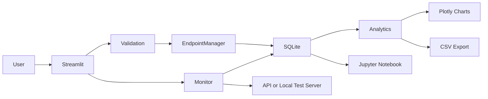

# API Reliability and Latency Analyzer

**Course:** IT Workshop III  
**Institution:** IIIT Kottayam  
**Project type:** One-month academic software project  
**Author:** [Student Name]  
**Date:** [Submission Date]

## Abstract
This project implements a local-first application for observing HTTP API reliability and latency. A modular Python engine performs user-initiated requests, measures elapsed time using a monotonic clock, classifies HTTP and transport failures, and persists monitoring records in SQLite. Pandas and NumPy compute reliability and latency summaries. Two explainable statistical methods—rolling-median comparison and interquartile range (IQR)—flag unusual latency values. A Streamlit dashboard presents monitoring history, endpoint comparisons, and CSV exports. A local mock server and pytest suite make core behavior reproducible without public internet services. Results should be reported from actual execution of the included experiments; this template intentionally does not invent benchmark numbers.

## 1. Introduction
APIs connect software systems, but their response time and availability can vary. Developers need to distinguish an unsuccessful HTTP response from a connection failure or timeout and review historical behavior instead of relying on a single check. Commercial observability platforms may be excessive for small projects, so this application demonstrates core monitoring concepts with standard local technologies.

## 2. Problem Statement
Build a maintainable local tool that can monitor selected HTTP endpoints, persist outcomes, calculate reliability and latency metrics, detect unusual latency patterns, and present the results interactively without requiring paid APIs or a cloud database.

## 3. Objectives and Scope
- Configure endpoints with expected status ranges and timeouts.
- Measure one-shot sequential or bounded concurrent requests.
- Store normalized endpoint, run, and attempt records.
- Calculate success/failure rates and latency statistics.
- Implement rolling-median and IQR anomaly detection.
- Provide a dashboard, CSV exports, tests, experiments, and a notebook.
- Keep requests explicit and limit the default monitoring surface to public HTTP/HTTPS destinations.

The application is an educational monitor, not a production SLA service, load generator, or continuous scheduler.

## 4. Existing Approaches and Motivation
Commercial monitoring systems commonly provide scheduled checks, alerting, dashboards, and integrations. This project focuses on the core ideas—measurement, persistence, aggregation, visualization, and anomaly flags—in a small and inspectable implementation. No unsupported comparison of commercial product performance is claimed.

## 5. Proposed System
The Streamlit UI calls validated endpoint-management and monitoring functions. The monitor measures request duration and classifies the outcome. SQLite stores configuration, run metadata, and per-attempt observations. Analytics and anomaly modules operate on the stored records and return tables for charts and export.

## 6. Requirements
### Functional
Endpoint CRUD/enable-disable; one-shot monitoring; expected status ranges; historical filtering; metric calculation; anomaly detection; endpoint comparison; CSV export; local mock experiments.

### Non-functional
Readable modular code; local execution; bounded concurrency; parameterized SQL; empty-state handling; safe error messages; reproducible tests; no mandatory API keys.

## 7. Environment
Python 3.11 is recommended. Main dependencies are requests (HTTP), Pandas/NumPy (analytics), SQLite via Python's standard library (storage), Streamlit (UI), Plotly (charts), pytest (tests), and Jupyter/nbformat (notebook). No cloud service is required.

## 8. Architecture

## 9. Module Descriptions
- `validation.py`: scheme, hostname/IP, method, timeout, and status-range validation.
- `endpoint_manager.py`: validated endpoint operations.
- `monitor.py`: HTTP calls, monotonic timing, failure categories, and bounded concurrency.
- `database.py`: schema initialization, parameterized queries, transactions, and history.
- `analytics.py`: reliability/latency metrics and endpoint aggregation.
- `anomaly_detection.py`: rolling-median and IQR flags.
- `export.py`: raw, aggregate, and anomaly CSV files.
- `app.py`: interactive presentation layer.

## 10. Database Design
Three tables separate configuration (`endpoints`), execution-level information (`monitoring_runs`), and attempt-level observations (`api_logs`). Foreign keys retain historical relationships. Indexes support time-range and endpoint-history lookups. SQL is parameterized and foreign-key enforcement is enabled per connection. See `DATABASE_SCHEMA.md` for columns and sample queries.

## 11. Monitoring Methodology
For each request, the monitor records a UTC timestamp and uses `time.monotonic()` to measure elapsed duration. A response is successful when its status code is inside the configured inclusive interval, default 200–299. A 404 response is a completed HTTP exchange but an unsuccessful monitoring result. A connection failure or timeout may have no HTTP status. Redirects are disabled and the response object is closed after reading the body length.

## 12. Statistical Metrics
Let N be the total number of attempts and S the number marked successful.

Success rate (%) = 100 × S / N  
Failure rate (%) = 100 × (N − S) / N

Latency statistics (minimum, maximum, mean, median, P95, standard deviation) use non-missing measured durations. Failures remain in reliability denominators; attempts with no measurable duration are not fabricated as zero latency. P95 uses NumPy's linear interpolation convention. The sample standard deviation uses `ddof=1` when at least two latency values exist. With no records, rates and latency statistics are represented as unavailable rather than misleading zeros.

## 13. Anomaly Detection
### Rolling median
The baseline for a measurement is computed from prior observations only. An observation is flagged when it is above the baseline plus a sensitivity-scaled historical deviation estimate; the implementation handles zero deviation by flagging values strictly above the baseline. Small history windows can be noisy and gradual trends can be missed.

### IQR
Q1 and Q3 are the 25th and 75th percentiles. IQR = Q3 − Q1. The high-latency upper fence is Q3 + k × IQR, with configurable k. The IQR rule is simple and robust to some outliers, but does not account for seasonality, workload changes, or endpoint-specific context. A flagged value is not proof of an API failure.

## 14. Concurrency
The monitor supports sequential mode and a bounded `ThreadPoolExecutor` mode. Because HTTP calls spend much of their time waiting for I/O, threads can overlap waits. A fixed upper limit avoids unbounded resource use. Each future maps back to its endpoint; one failure is converted to a record rather than terminating all work. A local artificial-delay server supports a fair comparison with equivalent endpoint workloads. Runtime results vary by machine and must be generated by executing the experiment script.

## 15. Dashboard
The dashboard includes overview metrics, endpoint management, one-shot monitoring, historical line and distribution charts, anomaly review, endpoint comparison, CSV downloads, and a settings/about section. Monitoring does not start on page load. Empty states explain what is missing.

## 16. Testing Methodology
Automated tests use temporary SQLite databases and an in-process local HTTP server. Test cases cover successful responses, 404/500, timeouts, connection failures, invalid URLs, database integrity, analytics, anomaly behavior, concurrent mapping, and empty input. Execute `python -m pytest -q` and paste the actual output into the final submission. The UI also needs manual interaction checks; 100% coverage is not claimed.

## 17. Experimental Setup and Results
Run `python scripts/run_local_test_server.py` in one terminal, then run `python scripts/run_experiments.py` in another. The script records actual elapsed times and success/failure counts in `outputs/experiment_results.json` and stores observations in `data/experiments.db`. Add the resulting values and machine details here after execution; do not insert illustrative values as measured results.

| Experiment | Configuration | Reported output |
|---|---|---|
| Reliability | Local fast, 404, 500, delayed and timeout routes | Actual run record counts and failure categories |
| Latency | Fast/delayed/variable local routes | Actual latency distribution from SQLite |
| Anomaly detection | Fixed-seed synthetic series with injected spikes | Flagged spike count and detector parameters |
| Concurrency | Same delayed endpoint collection, sequential vs bounded concurrent | Actual elapsed seconds from the experiment output |

## 18. Security and Ethical Considerations
The application accepts only HTTP/HTTPS, rejects embedded URL credentials, blocks private/loopback/reserved destinations by default, revalidates before the request, disables redirects, bounds timeouts and concurrency, truncates error messages, and does not store bodies or credentials. Local testing is explicit. These checks reduce risk but do not completely eliminate SSRF due to DNS rebinding and network routing. Only test endpoints with authorization and avoid load testing public services.

## 19. Limitations
Monitoring is user-triggered, not continuous. The application lacks authentication, alerting, distributed storage, and network-level egress enforcement. A small sample cannot establish long-term uptime. IQR and rolling median are intentionally lightweight and may miss trend/seasonality-related anomalies. The baseline UI does not automate all browser interactions in pytest.

## 20. Conclusion
The project demonstrates an end-to-end Python monitoring workflow: safe endpoint configuration, request measurement, persistent history, statistical analysis, anomaly flagging, concurrent I/O, visualization, and automated testing. Its local mock server supports repeatable experiments without reliance on external services.

## 21. Future Enhancements
Add configurable scheduled monitoring, notification channels, authentication profiles backed by a secure secret store, retention UI, stronger network-level SSRF protection, richer request templates, and longer-term trend models.

## 22. References
- Python documentation: https://docs.python.org/3/
- Requests documentation: https://requests.readthedocs.io/
- SQLite documentation: https://www.sqlite.org/docs.html
- Pandas documentation: https://pandas.pydata.org/docs/
- NumPy documentation: https://numpy.org/doc/
- Streamlit documentation: https://docs.streamlit.io/
- Plotly Python documentation: https://plotly.com/python/
- pytest documentation: https://docs.pytest.org/

## Appendix A: Execution Commands
See the root `README.md` for Windows and Linux/macOS setup, local server, experiment, notebook, and test commands.
